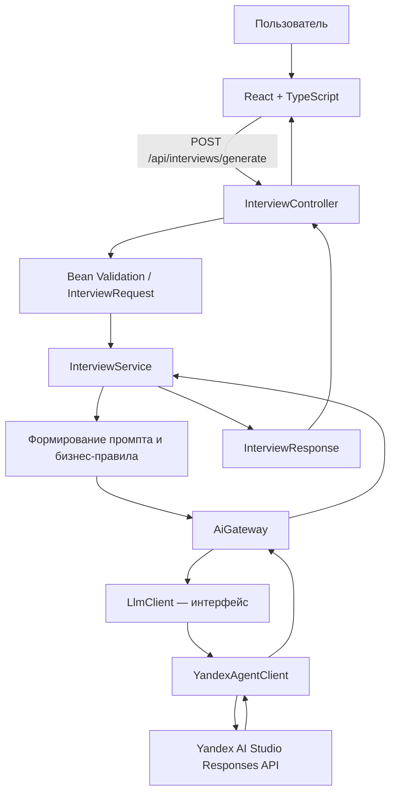

# Отчёт по лабораторной работе: HR-Ai и архитектура AI Gateway

**Проект:** HR-Ai — генератор сценариев собеседования по описанию вакансии  
**Стек:** React + TypeScript, Java 21, Spring Boot, Yandex AI Studio Agent, Maven, Docker  
**Репозиторий:** https://github.com/DocesForg/HR-Ai  
**Ветка разработки:** `feat/yandex-agent-react-app`

> **О статусе проверки.** Отчёт подготовлен по исходному коду и документации репозитория. В рамках подготовки этого файла я не запускал Maven-тесты, frontend-сборку и реальный запрос к Yandex AI Studio. Поэтому ниже отдельно обозначены реализованные механизмы, результаты статического анализа и проверки, которые ещё требуется выполнить. Примеры ответов LLM в разделе сравнения контекстов — демонстрационные образцы для анализа, а не результаты зафиксированного реального вызова модели.

## 1. Описание варианта

### 1.1. Предметная область

HR-Ai автоматизирует подготовку технических и поведенческих собеседований. Рекрутер или руководитель команды задаёт описание вакансии и при необходимости уточняет должность, уровень специалиста и фокус интервью. Приложение формирует структурированный сценарий вопросов, который помогает оценить соответствие кандидата требованиям вакансии.

Инструмент предназначен для поддержки интервьюера, а не для автоматического принятия кадровых решений. Сгенерированные вопросы необходимо проверять на соответствие вакансии, корректность и отсутствие дискриминационных формулировок.

### 1.2. Задача

Разработать веб-приложение, которое:

1. принимает параметры вакансии через React-интерфейс;
2. проверяет обязательное описание и ограничения длины полей;
3. формирует контекстный запрос к языковой модели;
4. обращается к Yandex AI Studio Agent через выделенный клиент;
5. возвращает сценарий собеседования в Markdown;
6. сообщает об ошибках API понятным сообщением и не раскрывает стек вызовов клиенту.

Серверная часть организована слоями: `Controller → Service → AiGateway → LlmClient → YandexAgentClient`.

### 1.3. Входные данные

Запрос отправляется методом `POST /api/interviews/generate` в формате JSON.

| Поле | Назначение | Ограничение |
|---|---|---|
| `vacancyDescription` | Описание вакансии | Обязательно, не более 12 000 символов |
| `position` | Название должности | Не более 120 символов |
| `seniority` | Уровень специалиста | Не более 80 символов |
| `questionFocus` | Направление интервью | Не более 80 символов |

Пример входных данных:

```json
{
  "vacancyDescription": "Разработка REST API на Java и Spring Boot, работа с PostgreSQL, code review и автоматизированными тестами.",
  "position": "Java-разработчик",
  "seniority": "Middle",
  "questionFocus": "Практические задачи и проектирование API"
}
```

### 1.4. Выходные данные

При успешной обработке сервер возвращает JSON с полями:

- `questions` — текст сценария интервью в Markdown;
- `provider` — название провайдера, сейчас `Yandex AI Studio Agent`;
- `requestId` — идентификатор конкретного ответа.

Сценарий должен группировать вопросы по компетенциям, указывать проверяемые навыки и признаки сильного ответа. При ошибке валидации возвращается HTTP 400, а при недоступности AI-сервиса — HTTP 503. Для непредвиденной серверной ошибки предусмотрен общий обработчик с HTTP 502 и нейтральным сообщением.

## 2. Диаграмма AI Gateway

### 2.1. Слои и поток данных



### 2.2. Назначение слоёв

- **Controller:** HTTP-контракт, привязка JSON к DTO, запуск Bean Validation и формирование HTTP-ответа. Бизнес-правила и форматирование промпта здесь не размещаются.
- **Service:** подготовка промпта из параметров вакансии, установка значений по умолчанию, проверка непустого результата, формирование DTO ответа. Здесь же применяются Resilience4j Retry и Circuit Breaker.
- **AiGateway:** точка входа в подсистему генерации. В текущей реализации делегирует вызов интерфейсу `LlmClient`.
- **LlmClient:** абстракция провайдера с операцией `generate(String input)`. Она позволяет менять реализацию клиента без привязки сервисного слоя к конкретному API.
- **YandexAgentClient:** проверяет наличие обязательной конфигурации, собирает запрос к Responses API, передаёт ключ авторизации и идентификатор проекта, извлекает текст из ответа.
- **Конфигурация:** `YandexProperties` получает параметры из `application.yml` и переменных окружения; `HttpClientConfig` задаёт тайм-ауты HTTP-клиента.

### 2.3. Провайдеры

В коде реализован один провайдер — Yandex AI Studio Agent. Интерфейс `LlmClient` создаёт возможность подключить альтернативный провайдер, но второй клиент, автоматическое переключение между провайдерами и сравнение нескольких моделей в работающем приложении пока не реализованы. Поэтому текущий механизм нельзя называть полноценным multi-provider fallback.

### 2.4. Guardrails — ограничения и защитные механизмы

| Механизм | Что реализовано | Ограничение |
|---|---|---|
| Валидация входа | `@NotBlank`, `@Size`, `@Valid` | Не проверяет смысловую полноту описания вакансии |
| Инструкции в промпте | Запрет дискриминационных вопросов и выдуманных требований | Инструкция модели не гарантирует соблюдение запрета |
| Проверка результата | Пустой ответ приводит к исключению | Нет полноценной проверки структуры, фактов и качества вопросов |
| Секреты | API-ключ берётся из `YANDEX_API_KEY` | Перед публикацией всё равно нужно проверить историю коммитов и настройки окружения |
| Логирование | Запрос к провайдеру логируется без содержимого промпта | Следует контролировать и другие точки логирования исключений |
| Надёжность | Тайм-ауты, Retry, Circuit Breaker | Требуется проверить реальное поведение при сбоях и повторных запросах |
| Ошибки API | Централизованный `ApiExceptionHandler` | Нужно проверить соответствие всех исключений корректным HTTP-кодам |

### 2.5. Оценка результата

В текущем коде реализована базовая техническая проверка: результат модели должен быть непустым. В сервисном тесте также проверяется, что ответ проходит через Gateway и содержит ожидаемый текст.

При этом автоматический оценщик качества ответа не реализован. Для следующей версии целесообразно оценивать результат по критериям:

1. **Релевантность:** каждый вопрос связан с описанием вакансии.
2. **Покрытие компетенций:** присутствуют все заявленные ключевые навыки.
3. **Конкретность:** вопрос позволяет получить проверяемый ответ, а не только общие рассуждения.
4. **Отсутствие дискриминации:** вопросы не затрагивают защищённые характеристики, не относящиеся к работе.
5. **Непридумывание требований:** модель не приписывает вакансии неуказанные технологии и обязанности.
6. **Структурированность:** Markdown читаем, вопросы сгруппированы, критерии сильного ответа присутствуют там, где нужны.

Оценку можно реализовать отдельным компонентом, например `InterviewAnswerEvaluator`, с детерминированными проверками и/или отдельным оценочным вызовом модели. Оценщик должен возвращать объяснимые замечания, а не просто скрытый числовой балл.

## 3. Листинги ключевых классов

Ниже приведены сокращённые листинги ключевых частей реализации. Полный код доступен в репозитории.

### 3.1. LlmClient — абстракция языковой модели

Файл: `src/main/java/ru/hrai/llm/LlmClient.java`

```java
package ru.hrai.llm;

public interface LlmClient {
    String generate(String input);
}
```

Интерфейс изолирует бизнес-логику от конкретного поставщика. Сейчас его реализует `YandexAgentClient`. При добавлении другого провайдера необходимо реализовать тот же контракт и отдельно определить правила выбора реализации.

### 3.2. AiGateway — единая точка доступа к LLM

Файл: `src/main/java/ru/hrai/llm/AiGateway.java`

```java
@Component
public class AiGateway {
    private final LlmClient client;

    public AiGateway(LlmClient client) {
        this.client = client;
    }

    public String generateInterviewQuestions(String prompt) {
        return client.generate(prompt);
    }
}
```

Gateway пока является тонким адаптером и не содержит собственной логики guardrails, выбора провайдера или оценки результата. Это полезная точка расширения, но по критерию «AI Gateway» текущая реализация минимальна.

### 3.3. Service — бизнес-логика

Файл: `src/main/java/ru/hrai/interview/service/InterviewService.java`

```java
@Service
public class InterviewService {
    private final AiGateway gateway;

    public InterviewService(AiGateway gateway) {
        this.gateway = gateway;
    }

    @Retry(name = "yandexAgent")
    @CircuitBreaker(name = "yandexAgent", fallbackMethod = "fallback")
    public InterviewResponse generate(InterviewRequest r) {
        String description = r.vacancyDescription().trim();

        String prompt = "Ты — опытный HR-эксперт и технический интервьюер. "
            + "Составь сценарий собеседования на русском языке в Markdown. "
            + "Группируй вопросы по компетенциям; укажи признаки сильного ответа. "
            + "Не добавляй дискриминационные вопросы и не выдумывай требования.\n"
            + "Должность: " + safe(r.position(), "Не указана") + "\n"
            + "Уровень: " + safe(r.seniority(), "Не указан") + "\n"
            + "Фокус: " + safe(r.questionFocus(), "Сбалансированный набор") + "\n"
            + "Описание вакансии:\n---\n" + description + "\n---";

        String answer = gateway.generateInterviewQuestions(prompt);
        if (!StringUtils.hasText(answer)) {
            throw new IllegalStateException("AI returned an empty answer");
        }
        return new InterviewResponse(
            answer, "Yandex AI Studio Agent", UUID.randomUUID().toString()
        );
    }

    public InterviewResponse fallback(InterviewRequest r, Throwable ex) {
        throw new AiUnavailableException(
            "Сервис генерации временно недоступен. Попробуйте ещё раз позже.", ex
        );
    }

    private String safe(String value, String fallback) {
        return StringUtils.hasText(value) ? value.trim() : fallback;
    }
}
```

Сервис объединяет поля запроса в промпт и проверяет, что модель вернула непустой текст. Важная оговорка: метод `fallback` не генерирует резервный сценарий и не переключается на другого поставщика — он преобразует сбой в контролируемое исключение.

### 3.4. Controller — HTTP API

Файл: `src/main/java/ru/hrai/interview/api/InterviewController.java`

```java
@RestController
@RequestMapping("/api/interviews")
public class InterviewController {
    private final InterviewService service;

    public InterviewController(InterviewService service) {
        this.service = service;
    }

    @PostMapping("/generate")
    public ResponseEntity<InterviewResponse> generate(
            @Valid @RequestBody InterviewRequest request) {
        return ResponseEntity.ok(service.generate(request));
    }
}
```

Контроллер не обращается к Yandex API напрямую. Он передаёт проверенный DTO сервису и возвращает его результат.

### 3.5. Конфигурация провайдера и HTTP-клиента

Файлы: `src/main/resources/application.yml`, `config/HttpClientConfig.java`, `config/YandexProperties.java`.

```yaml
app:
  yandex:
    base-url: https://ai.api.cloud.yandex.net/v1
    api-key: ${YANDEX_API_KEY:}
    project-id: ${YANDEX_PROJECT_ID:b1gfj3v8keh3qobuh6rv}
    agent-id: ${YANDEX_AGENT_ID:fvt526o3mhjmd9f6l2te}
    connect-timeout-seconds: 5
    read-timeout-seconds: 90

resilience4j:
  retry:
    instances:
      yandexAgent:
        max-attempts: 2
        wait-duration: 500ms
        enable-exponential-backoff: true
        exponential-backoff-multiplier: 2
  circuitbreaker:
    instances:
      yandexAgent:
        sliding-window-size: 10
        minimum-number-of-calls: 4
        failure-rate-threshold: 50
        wait-duration-in-open-state: 30s
```

```java
@Configuration
public class HttpClientConfig {
    @Bean
    RestClient yandexRestClient(YandexProperties p) {
        var factory = new SimpleClientHttpRequestFactory();
        factory.setConnectTimeout(Duration.ofSeconds(p.connectTimeoutSeconds()));
        factory.setReadTimeout(Duration.ofSeconds(p.readTimeoutSeconds()));
        return RestClient.builder()
            .baseUrl(p.baseUrl())
            .requestFactory(factory)
            .build();
    }
}
```

API-ключ не задан литералом: приложение читает его из окружения. Повторные попытки ограничены двумя попытками, а Circuit Breaker открывается после достижения настроенного порога ошибок. Конкретное поведение аннотаций и тайм-аутов следует подтвердить запуском тестов и испытаниями с недоступным API.

### 3.6. Реализация YandexAgentClient

Клиент реализует `LlmClient`, проверяет ключ и ID агента, отправляет POST-запрос на `/responses`, передаёт `Bearer`-авторизацию и заголовок `OpenAI-Project`. В тело запроса включены ID агента, входной текст и инструмент `web_search`. Клиент пытается извлечь `output_text`, а при его отсутствии разбирает текстовые блоки `output`.

Ключевой принцип безопасности: текст промпта намеренно не записывается в лог. Необходимо также избегать журналирования заголовков авторизации, содержимого ответа модели и пользовательских данных.

## 4. README-AI.md: правила для AI-ассистента

Файл `README-AI.md` описывает ограничения разработки и поведения AI-ассистента.

### Разрешено

- Сохранять архитектуру `Controller → Service → AiGateway → LlmClient → provider client`.
- Использовать русский язык по умолчанию и создавать вопросы, связанные с рабочими компетенциями.
- Добавлять новые реализации `LlmClient`, если это не привязывает бизнес-логику к одному API.
- Использовать переменные окружения для секретов и настраивать тайм-ауты внешних запросов.
- Добавлять ограниченные Retry, Circuit Breaker, валидацию и тесты на JUnit/Mockito.
- Обновлять README и OpenAPI при изменении API-контрактов.
- Делать небольшие изменения, поддерживать доступность интерфейса, состояния загрузки и ошибок.
- Запускать `mvn test` и `npm run build` до утверждения, что сборка успешна.

### Запрещено

- Помещать API-ключи в репозиторий, YAML, документацию или frontend.
- Записывать в логи тексты вакансий, ответы модели, персональные данные, токены и заголовки авторизации.
- Размещать бизнес-логику и генерацию промпта в контроллере.
- Вызывать Yandex API напрямую из бизнес-логики в обход `LlmClient`.
- Возвращать клиенту трассировки стека и секреты.
- Создавать дискриминационные вопросы или приписывать вакансии требования, которых нет во входных данных.
- Размещать реальные секреты в переменных `VITE_...`, поскольку они могут попасть в браузерный бандл.

README-AI задаёт полезные правила, но является инструкцией для разработки, а не техническим барьером. Критичные требования — защита секретов, валидация и безопасная обработка ошибок — должны обеспечиваться кодом, настройками CI и проверками.

## 5. Сравнение контекстов: два ответа LLM

### 5.1. Условия сравнения

Для сравнения используется одна вакансия: Java-разработчик уровня Middle, стек Java, Spring Boot, REST API, PostgreSQL и автоматизированные тесты.

- **Контекст A — минимальный:** «Составь вопросы для собеседования Java-разработчика».
- **Контекст B — расширенный:** описание вакансии, уровень Middle, перечисленные технологии, фокус на практических задачах и проектировании API, требование сгруппировать вопросы по компетенциям и описать признаки сильного ответа.

Следующие ответы — **иллюстративные примеры ожидаемого различия**, подготовленные для методики анализа. Это не дословные ответы Yandex Agent и не результат фактически выполненного сравнения двух вызовов.

### 5.2. Ответ A: минимальный контекст

> 1. Что такое ООП и какие его принципы вы знаете?  
> 2. Чем отличаются интерфейс и абстрактный класс в Java?  
> 3. Что такое Spring и для чего используется Dependency Injection?  
> 4. Что такое REST API?  
> 5. Чем отличаются SQL и NoSQL?  
> 6. Как вы тестируете свой код?  
> 7. Расскажите о сложной задаче, которую вы решали.

**Анализ ответа A.** Вопросы в целом относятся к профессии, но они универсальны. Неясно, какие вопросы проверяют уровень Middle, насколько глубоко нужно обсуждать Spring Boot и PostgreSQL, есть ли практическая задача и по каким критериям интервьюер оценивает ответ. Ответ можно применить как начальный список, но он требует существенной доработки.

### 5.3. Ответ B: расширенный контекст

> **Компетенция: проектирование REST API**  
> Спроектируйте endpoint для постраничного получения заказов с фильтрами и сортировкой. Как выберете HTTP-метод, коды ответов, формат ошибок и стратегию обратной совместимости?  
> **Признаки сильного ответа:** корректные HTTP-семантика и статус-коды, валидация параметров, предсказуемая схема ошибок, ограничения на размер страницы и обсуждение версионирования.
>
> **Компетенция: Spring Boot и транзакции**  
> Сервис обновляет заказ и записывает событие аудита. Что произойдёт при исключении между двумя операциями и как обеспечить согласованность?  
> **Признаки сильного ответа:** объяснение границ транзакции, поведения rollback, изоляции и альтернатив вроде transactional outbox там, где она обоснована.
>
> **Компетенция: PostgreSQL**  
> Запрос списка заказов стал медленным после роста таблицы. Как будете искать причину и решать проблему?  
> **Признаки сильного ответа:** анализ плана выполнения, селективности фильтров, индексов, фактических измерений и компромиссов при записи.
>
> **Компетенция: тестирование**  
> Как протестировать сервис, который обращается к внешнему API и базе данных? Какие сценарии проверять модульными, интеграционными и контрактными тестами?  
> **Признаки сильного ответа:** изоляция зависимостей в unit-тестах, проверка реального взаимодействия на интеграционном уровне, негативные сценарии и отсутствие нестабильных тестов.

**Анализ ответа B.** Вопросы опираются на конкретные технологии и практические обязанности вакансии. Ожидаемые признаки сильного ответа помогают интервьюеру сравнивать ответы кандидатов по единым критериям. При этом ответ B не обязательно лучше во всех ситуациях: он может быть избыточным для начального уровня или для вакансии с иным набором обязанностей.

### 5.4. Сравнительная таблица

| Критерий | Контекст A | Контекст B |
|---|---|---|
| Привязка к вакансии | Низкая | Высокая |
| Глубина | В основном определения | Сценарии и проектирование |
| Учитывание уровня | Неявное | Указан уровень Middle |
| Оценивание | Нет критериев | Есть признаки сильного ответа |
| Риск лишних вопросов | Выше | Ниже при точном описании вакансии |
| Требования к проверке человеком | Высокие | Остаются обязательными |

**Вывод:** качество контекста заметно влияет на полезность результата. Полезный контекст включает не только название должности, но и обязанности, технологии, уровень, формат интервью и критерии оценки. Однако подробный промпт не устраняет галлюцинации и не заменяет проверку интервьюером.

Чтобы получить эмпирические результаты, следует отправить оба контекста одной и той же модели при одинаковых настройках, сохранить ответы и дату запуска, затем оценить их по общей шкале. В отчёт нужно подставить фактически полученные ответы, если преподаватель требует именно экспериментальные результаты.

## 6. Разбор AI-сгенерированного прототипа

### 6.1. Что получилось удачно

- Разделены HTTP-контроллер, бизнес-логика, Gateway и провайдер.
- Есть интерфейс `LlmClient`, поэтому вызов модели не зашит непосредственно в контроллер.
- Используется DTO с Bean Validation и ограничениями длины входных данных.
- Секрет передаётся через переменную окружения, а не из frontend-кода.
- В HTTP-клиенте заданы тайм-ауты соединения и чтения.
- Предусмотрены Retry, Circuit Breaker, централизованный обработчик ошибок и логирование без текста промпта.
- Присутствуют базовые unit-тесты сервисного слоя и инструкции по проверке проекта.

### 6.2. Выявленные ограничения и предлагаемые исправления

1. **Gateway почти не содержит логики.** Сейчас он только вызывает `client.generate(prompt)`.  
   **Исправление:** выделить интерфейсы для проверки входа, оценки результата и политики выбора провайдера; оставить Gateway ответственным за координацию этих этапов.

2. **Нет реального multi-provider fallback.** Текущий `fallback` выбрасывает `AiUnavailableException`, а не использует альтернативную модель.  
   **Исправление:** если требуется резервный провайдер, добавить вторую реализацию `LlmClient`, задать политику переключения и тесты на отказ основного провайдера. Если второй провайдер не нужен, называть механизм корректнее «обработкой отказа», а не fallback-моделью.

3. **Оценка качества ответа минимальна.** Проверяется только непустой текст.  
   **Исправление:** добавить валидацию структуры ответа, проверку наличия компетенций и критериев оценки, а также ручную выборочную оценку качества.

4. **Тестовое покрытие ограничено.** В репозитории обнаружен `InterviewServiceTest` с двумя тестами: успешный путь через Gateway и реакция на пустой ответ. Это не покрывает весь путь HTTP → модель.  
   **Исправление:** добавить тесты контроллера, обработчика ошибок, `YandexAgentClient` с замоканным HTTP-клиентом, конфигурации и сценариев Retry/Circuit Breaker.

5. **Сборка и интеграция требуют фактической проверки.** Сам факт наличия CI-файла не означает, что pipeline успешно прошёл.  
   **Исправление:** запустить Maven-тесты и frontend build, проверить CI в GitHub Actions и отдельно выполнить smoke test с действующим секретом, не помещая его в отчёт или логи.

6. **Обработка ошибок внешнего API требует негативных тестов.** Следует убедиться, что ошибки авторизации, тайм-ауты, пустое тело и неожиданная структура ответа не приводят к утечке данных или непонятному HTTP-ответу.

7. **Ограничения prompt-based защиты.** Запрет дискриминационных вопросов прописан в промпте, но модель может не выполнить инструкцию.  
   **Исправление:** применять дополнительную проверку результата и человеческое подтверждение перед использованием сценария.

8. **Инструмент web_search расширяет возможности, но увеличивает поверхность риска.** Для генерации вопросов по вакансии веб-поиск может быть не нужен в каждом сценарии.  
   **Исправление:** проверить необходимость инструмента; при необходимости ограничить его применение, оценить качество источников и исключить следование инструкциям из недоверенных веб-страниц.

9. **Конфигурация по умолчанию содержит идентификаторы проекта и агента.** Это не секреты, в отличие от API-ключа, но значения должны быть конфигурируемыми и соответствовать окружению развёртывания.

### 6.3. Риски

- **Галлюцинации:** модель может придумать технологию или обязанность, отсутствующую в вакансии.
- **Смещение и дискриминация:** формулировки могут содержать необоснованные требования или вопросы, не связанные с работой.
- **Утечка данных:** описание вакансии или ответ могут содержать конфиденциальную информацию; их нельзя без необходимости писать в логи.
- **Зависимость от провайдера:** недоступность API, изменение формата ответа или квотирование нарушают генерацию.
- **Повторные вызовы:** Retry может повторить запрос после временной ошибки и увеличить задержку или расход квоты.
- **Недостоверные критерии оценки:** признаки «сильного ответа» сами по себе не являются валидированной методикой оценки кандидатов.

## 7. Тесты и результаты проверки

### 7.1. Имеющиеся unit-тесты

Файл: `src/test/java/ru/hrai/interview/service/InterviewServiceTest.java`.

Тест успешного сценария:

```java
@Test
void generatesQuestionsThroughGateway() {
    AiGateway gateway = mock(AiGateway.class);
    when(gateway.generateInterviewQuestions(anyString()))
        .thenReturn("## Технические вопросы\n1. Расскажите об опыте.");

    InterviewService service = new InterviewService(gateway);
    var result = service.generate(new InterviewRequest(
        "Java, Spring Boot, REST API",
        "Java-разработчик",
        "Middle",
        "Практика"
    ));

    assertTrue(result.questions().contains("Технические вопросы"));
    assertEquals("Yandex AI Studio Agent", result.provider());
    verify(gateway).generateInterviewQuestions(argThat(p ->
        p.contains("Java-разработчик")
            && p.contains("Java, Spring Boot, REST API")
    ));
}
```

Тест пустого результата:

```java
@Test
void rejectsBlankGeneratedText() {
    AiGateway gateway = mock(AiGateway.class);
    when(gateway.generateInterviewQuestions(anyString())).thenReturn(" ");

    InterviewService service = new InterviewService(gateway);

    assertThrows(IllegalStateException.class, () ->
        service.generate(new InterviewRequest(
            "Описание вакансии", null, null, null
        ))
    );
}
```

Первый тест проверяет формирование контекста, передачу его через Gateway и заполнение ответа. Второй проверяет, что пустой ответ не считается успешной генерацией.

### 7.2. Результаты запуска

| Проверка | Статус в рамках подготовки отчёта |
|---|---|
| Просмотр исходников и конфигурации | Выполнен |
| Проверка наличия двух unit-тестов сервиса | Выполнена по исходному коду |
| `mvn test` | Не запускался в рамках подготовки этого отчёта |
| `cd frontend && npm run build` | Не запускался в рамках подготовки этого отчёта |
| CI GitHub Actions | Успешный статус не подтверждён |
| Реальный запрос к Yandex AI Studio Agent | Не выполнялся |
| Проверка поведения при тайм-ауте и ошибке авторизации | Не выполнялась |

**Важно:** таблица не утверждает, что тесты прошли или сборка успешна. Для завершения экспериментальной части нужно выполнить команды в окружении с Java 21, Maven, Node.js 20+ и npm:

```bash
mvn test
cd frontend
npm ci
npm run build
```

Smoke test провайдера выполняется отдельно с действительным `YANDEX_API_KEY`, заданным только через окружение. Сам ключ не нужно вставлять в команду, отчёт, коммит или логи.

### 7.3. Рекомендуемые дополнительные тесты

- Пустое описание и превышение лимита длины дают HTTP 400.
- Успешный запрос контроллера возвращает DTO с текстом, провайдером и requestId.
- Ошибка провайдера приводит к контролируемому HTTP 503 без stack trace.
- `YandexAgentClient` отклоняет отсутствие API-ключа и ID агента до HTTP-вызова.
- Клиент корректно обрабатывает пустой ответ и обе поддерживаемые формы текстового результата.
- Тайм-аут, 429 и 5xx проверяются отдельно с учётом политики повторов.
- Проверяется, что секрет и содержимое промпта не появляются в логах.
- Проверяется работа Circuit Breaker после порога ошибок и восстановление после периода ожидания.

## 8. Выводы

В результате разработки создан прототип генератора сценариев собеседования с React-интерфейсом и Spring Boot API. Реализованы базовое разделение слоёв, интерфейс `LlmClient`, клиент Yandex AI Studio Agent, валидация DTO, конфигурация через переменные окружения, HTTP-тайм-ауты, Retry, Circuit Breaker, обработка ошибок и два unit-теста сервисного слоя.

Самое важное архитектурное решение — отделить сервисную логику от конкретного LLM API. Это упрощает тестирование и потенциальную замену провайдера. При этом Gateway пока минимален, а резервный сценарий представляет собой контролируемую ошибку, а не автоматическое переключение на другую модель.

Ограничения: отсутствует автоматический оценщик качества, не реализован второй провайдер, тесты охватывают только часть сервисного поведения, а реальная интеграция и сборка в рамках подготовки отчёта не запускались. Эти ограничения нельзя скрывать при оценке результата.

AI полезен для создания исходного каркаса приложения, шаблонов слоёв и первичных тестов, но сгенерированный код нужно проверять самостоятельно. В частности, наличие названия `AiGateway` не гарантирует полноценную реализацию guardrails, а наличие метода `fallback` не означает наличие резервного провайдера. Самостоятельная проверка должна включать реальные команды сборки, негативные сценарии, аудит логирования и испытание интеграции с провайдером.

## 9. Ответы на контрольные вопросы

В исходном задании конкретный перечень контрольных вопросов не приложен. Ниже приведены ответы на типовые вопросы по теме лабораторной работы; при наличии официального списка их следует сопоставить с ним.

**1. Что такое AI Gateway и зачем он нужен?**  
AI Gateway — единая точка доступа к языковым моделям. Он изолирует прикладной код от API конкретного провайдера и является естественным местом для маршрутизации, ограничений, наблюдаемости и оценки результата. В HR-Ai текущий Gateway пока реализует только делегирование в `LlmClient`.

**2. Для чего нужен интерфейс LlmClient?**  
Он задаёт общий контракт генерации текста. Сервис зависит от абстракции, а не от Yandex API, что упрощает mock-тестирование и добавление других клиентов. Сам интерфейс не реализует выбор или переключение провайдера автоматически.

**3. Чем отличаются Retry и Circuit Breaker?**  
Retry повторяет отдельный вызов при подходящей ошибке, ограничивая число попыток. Circuit Breaker временно блокирует обращения, если доля ошибок превышает порог, помогая не перегружать неисправную зависимость. Неправильные настройки могут увеличить задержки и количество запросов.

**4. Что такое guardrails?**  
Это механизмы ограничения входных данных и результата: валидация, правила промпта, фильтрация, проверка формата, ограничения доступа и безопасная обработка ошибок. Одной инструкции в промпте недостаточно для гарантированной защиты.

**5. Почему секреты нельзя хранить во frontend или репозитории?**  
Код frontend доставляется браузеру и доступен пользователю. Секрет, попавший в Git, может остаться в истории даже после удаления файла. Ключи нужно хранить в защищённых переменных окружения или хранилище секретов и при утечке отзывать.

**6. Чем unit-тест отличается от интеграционного теста?**  
Unit-тест проверяет небольшой компонент изолированно, например сервис с mock-объектом Gateway. Интеграционный тест проверяет совместную работу нескольких реальных компонентов — например, HTTP-контроллера, конфигурации и клиента. Unit-тест с mock не подтверждает доступность внешнего API.

**7. Почему важно проверять ответ модели?**  
Модель может вернуть пустой, нерелевантный или ошибочный текст. Проверка результата позволяет обнаруживать часть проблем, но качество содержания требует более глубоких проверок и, в HR-сценариях, человеческого контроля.

**8. Что означает fallback в приложении?**  
Fallback — альтернативный путь обработки отказа. В текущем приложении метод с именем `fallback` преобразует ошибку в `AiUnavailableException`; он не генерирует ответ и не переключает запрос на другую модель. Поэтому это fallback-обработчик ошибки, но не резервный LLM-провайдер.

**9. Как оценивать качество генерации?**  
Следует использовать единые критерии релевантности вакансии, полноты компетенций, конкретности вопросов, корректности и отсутствия дискриминации. Для сравнения моделей необходимо сохранять одинаковые входные контексты и фактические ответы, затем оценивать их по одной шкале.

**10. Какие проверки нужно выполнить перед сдачей?**  
Запустить `mvn test`, `npm ci` и `npm run build`, проверить GitHub Actions, выполнить smoke test с действующим ключом, проверить ошибки 400/502/503, тайм-ауты, отсутствие секретов в логах и поведение при недоступности провайдера.

## 10. Список использованных источников

1. Репозиторий проекта HR-Ai: https://github.com/DocesForg/HR-Ai
2. README проекта: https://github.com/DocesForg/HR-Ai/blob/main/README.md
3. Правила разработки AI-ассистента README-AI.md: https://github.com/DocesForg/HR-Ai/blob/main/README-AI.md
4. Документация Spring Boot: https://docs.spring.io/spring-boot/
5. Документация Spring Framework по REST-клиентам: https://docs.spring.io/spring-framework/reference/integration/rest-clients.html
6. Документация Jakarta Bean Validation: https://beanvalidation.org/
7. Документация Resilience4j: https://resilience4j.readme.io/
8. Документация JUnit 5: https://junit.org/junit5/docs/current/user-guide/
9. Документация Mockito: https://javadoc.io/doc/org.mockito/mockito-core/latest/org/mockito/Mockito.html
10. Документация Yandex Cloud AI Studio: https://yandex.cloud/en/docs/ai-studio/
11. Документация GitHub Actions: https://docs.github.com/en/actions

